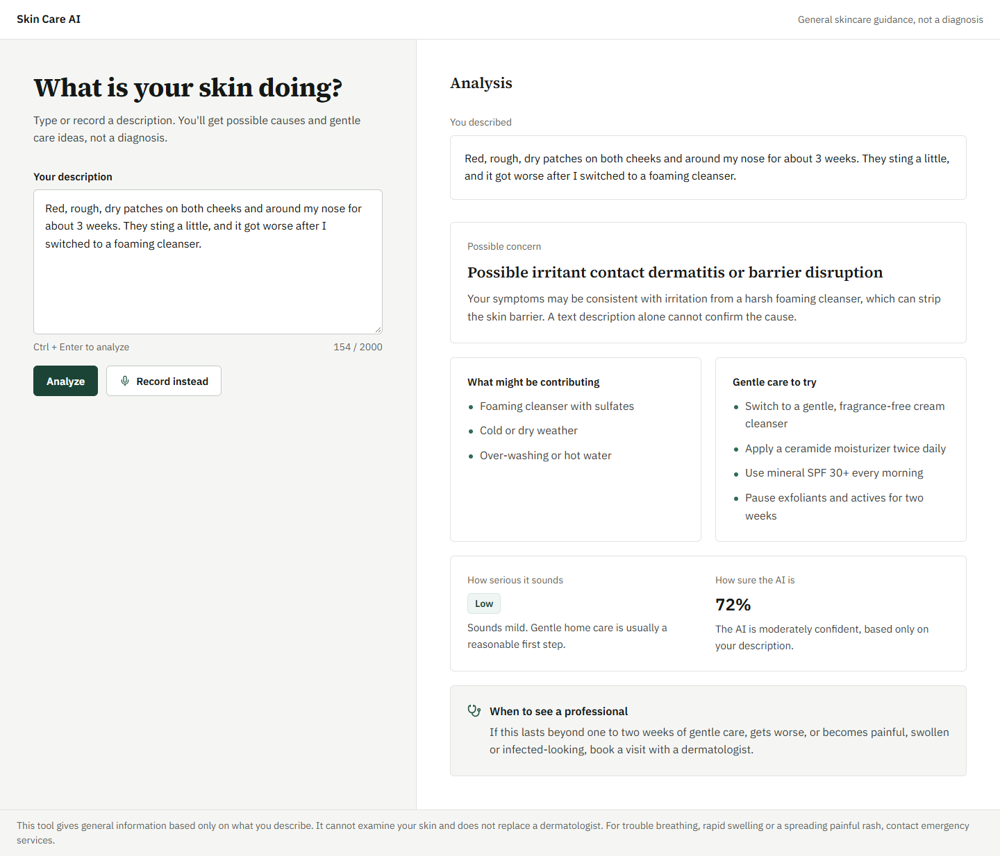
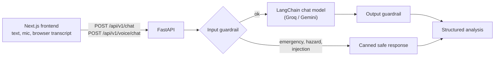

# Skin Care AI

A safety-first web app that turns a typed or spoken description of a skin concern into cautious, structured skincare guidance: possible causes, gentle over-the-counter care, a severity estimate, and a clear signal for when to see a dermatologist.

It does not diagnose. Every request passes through input and output guardrails, and the model layer is provider-neutral through LangChain, so the app runs on Groq's free tier today and can switch to Gemini or another provider with a one-line config change.



## Features

- **Text and voice input.** Type a description or record it. The browser's own speech recognition transcribes for free; the backend can transcribe server-side when the browser can't.
- **Structured analysis.** Possible concern, contributing factors, care suggestions, severity (`low` / `medium` / `high` / `unknown`), confidence, and a "see a professional" flag, validated against a strict schema.
- **Medical safety guardrails.**
  - Emergencies (e.g. trouble breathing) and hazardous self-treatment (bleach, self-surgery) get an immediate safe response without calling the model.
  - Definitive diagnoses in the output are softened, and prescription drugs are flagged.
  - Red-flag symptoms escalate severity, with negation awareness so "no fever" doesn't count as a fever.
- **Prompt-injection and secret-extraction defense**, tuned so ordinary skincare questions are not blocked.
- **Spoken summary.** Server text-to-speech on Gemini, or the browser's built-in voice on other providers.
- **Swappable AI provider.** Groq and Gemini are supported out of the box; other LangChain providers work for analysis after installing their integration.
- **Built for free-tier budgets.**
  - No automatic retries on quota errors.
  - Bounded retries only when the provider is overloaded, plus an optional fallback model.
  - Blocked messages never reach the provider.
- **Offline test suite.** 111 tests run with a fake key and all outbound network calls blocked, so tests never spend API quota.

## How it works



Voice requests use the browser transcript when present, otherwise server transcription (Groq Whisper or Gemini). After analysis the backend builds a short spoken summary; if speech synthesis fails or is disabled, the analysis is still returned and the frontend reads it aloud with the browser's voice.

## Tech stack

| Layer | Technology |
|---|---|
| Backend | Python 3.10+, FastAPI, Pydantic v2, LangChain, uv |
| AI providers | Groq (`openai/gpt-oss-120b`, Whisper), Google Gemini |
| Frontend | Next.js 16 (App Router), React 19, Tailwind CSS 4, Lucide icons |
| Testing | pytest with offline fakes and a network block |

## Getting started

### Prerequisites

- Python 3.10+ and [uv](https://github.com/astral-sh/uv)
- Node.js 20+
- A free [Groq API key](https://console.groq.com/keys) (or a Gemini key)

### 1. Backend

```bash
cd backend
uv sync
cp .env.example .env        # then set GROQ_API_KEY
uv run uvicorn app.main:app --reload --port 8000
```

Interactive API docs: http://localhost:8000/docs

### 2. Frontend

```bash
cd frontend
npm install
cp .env.example .env.local  # optional; defaults to http://localhost:8000
npm run dev
```

Open http://localhost:3000.

## Configuration

All settings live in `backend/.env`; see [`backend/.env.example`](backend/.env.example) for the full list.

| Variable | Purpose | Default |
|---|---|---|
| `LLM_PROVIDER` | `groq`, `google_genai`, or another LangChain provider | `google_genai` |
| `GROQ_API_KEY` / `GEMINI_API_KEY` / `LLM_API_KEY` | API key (`LLM_API_KEY` takes precedence) | none |
| `LLM_MODEL`, `LLM_FALLBACK_MODEL`, `LLM_STT_MODEL` | Model overrides | per provider |
| `LLM_MAX_RETRIES` | Extra SDK retries after the first attempt | `0` |
| `LLM_OVERLOAD_RETRIES` | Retries on 500/502/503 only | `2` |
| `USE_CLIENT_TRANSCRIPT` | Use the browser transcript instead of server STT | `true` |
| `TTS_ENABLED` | Server speech synthesis (Gemini only) | on for Gemini |
| `CORS_ORIGINS` | Allowed frontend origins | `localhost:3000` |

Per-provider defaults:

| | Groq | Gemini |
|---|---|---|
| Analysis | `openai/gpt-oss-120b` (fallback `openai/gpt-oss-20b`) | `gemini-3.8-flash` |
| Transcription | `whisper-large-v3-turbo` | `gemini-3.5-flash` |
| Spoken reply | Browser voice | `gemini-3.8-flash-tts` |

## Testing

```bash
cd backend
uv run pytest
```

The suite never calls a real provider: `tests/conftest.py` sets a fake key and blocks every non-loopback network connection.

## Project structure

```text
skin-care-ai/
├── backend/
│   ├── app/
│   │   ├── api/            # FastAPI routes and dependency providers
│   │   ├── core/           # Settings, guardrails, prompts, exceptions
│   │   ├── schemas/        # Request/response models and the model output schema
│   │   └── services/       # LangChain model factory, analysis, speech-to-text, text-to-speech
│   └── tests/              # Offline pytest suite
├── frontend/
│   ├── app/                # Next.js App Router entry, layout, global styles
│   ├── components/         # Chat, layout and UI components
│   └── lib/                # API client
└── docs/                   # README assets
```

## Disclaimer

Skin Care AI provides general educational information based only on what a user describes. It cannot examine skin, does not diagnose or prescribe, and is not a substitute for a dermatologist or doctor. For trouble breathing, rapid swelling, or a spreading, painful rash, contact emergency services.
